<p align="center">
  
</p>

<h1 align="center">Medi Trace</h1>

<p align="center">
  <strong>Every Batch. Every Journey. Verified.</strong><br>
  <em>An enterprise-grade, anti-counterfeit pharmaceutical verification, cold-chain IoT telemetry, and cryptographic blockchain traceability platform.</em>
</p>

<p align="center">
  <a href="https://nodejs.org/"></a>
  <a href="https://vitejs.dev/"></a>
  <a href="https://www.postgresql.org/"></a>
  <a href="https://www.electronjs.org/"></a>
  <a href="https://www.hyperledger.org/"></a>
  <a href="https://www.fda.gov/"></a>
  <a href="#-live-animated-telemetry--forensic-visualizers"></a>
  <a href="#-ui-design-system--sensory-highlights"></a>
  <a href="#-page-1-cyber-pharma-authentication-portal-login"></a>
</p>

<p align="center">
  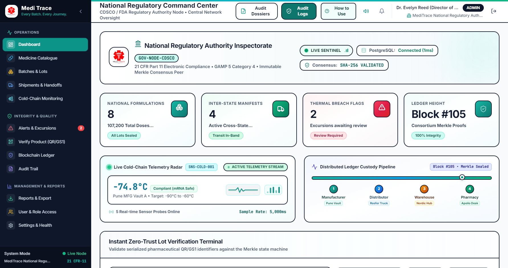
</p>

---

## 📋 Table of Contents

- [Overview](#-overview)
- [Key Architectural Pillars](#-key-architectural-pillars)
- [Live Animated Telemetry & Forensic Visualizers](#-live-animated-telemetry--forensic-visualizers)
- [Live UI Showcase & Visual Tour](#-live-ui-showcase--visual-tour)
- [Web Application & Site Access](#-web-application--site-access)
- [Site Navigation & Complete Page-by-Page Tour](#-site-navigation--complete-page-by-page-tour)
  - [Page 1: Cyber-Pharma Authentication Portal (`/login`)](#-page-1-cyber-pharma-authentication-portal-login)
  - [Interactive Onboarding: "How to Use" User Guide Modal](#-interactive-onboarding-how-to-use-user-guide-modal)
  - [Page 2: Role-Tailored Command Dashboards (`/`)](#-page-2-role-tailored-command-dashboards-)
  - [Page 3: Pharmaceutical Medicine Catalogue (`/medicines`)](#-page-3-pharmaceutical-medicine-catalogue-medicines)
  - [Page 4: Batch Serialization & Lot Lifecycle (`/batches`)](#-page-4-batch-serialization--lot-lifecycle-batches)
  - [Page 5: Custody Shipments & Transport Manifests (`/shipments`)](#-page-5-custody-shipments--transport-manifests-shipments)
  - [Page 6: Chain-of-Custody Handoff History (`/handoffs`)](#-page-6-chain-of-custody-handoff-history-handoffs)
  - [Page 7: Real-Time Cold-Chain IoT Monitoring & GIS Route Radar (`/cold-chain`)](#-page-7-real-time-cold-chain-iot-monitoring--gis-route-radar-cold-chain)
  - [Page 8: Excursion Alerts & CAPA Resolution (`/alerts`)](#-page-8-excursion-alerts--capa-resolution-alerts)
  - [Page 9: Zero-Trust Anti-Counterfeit Verification Station (`/verify`)](#-page-9-zero-trust-anti-counterfeit-verification-station-verify)
  - [Page 10: Distributed Blockchain Ledger Explorer (`/blockchain`)](#-page-10-distributed-blockchain-ledger-explorer-blockchain)
  - [Page 11: 21 CFR Part 11 Electronic Security Audit Trail (`/audit-logs`)](#-page-11-21-cfr-part-11-electronic-security-audit-trail-audit-logs)
  - [Page 12: Regulatory Dossiers & Role-Tailored PDF Export (`/reports`)](#-page-12-regulatory-dossiers--role-tailored-pdf-export-reports)
  - [Page 13: Multi-Tenant User Directory & Permissions (`/users`)](#-page-13-multi-tenant-user-directory--permissions-users)
  - [Page 14: Node Health Probes & System Diagnostics (`/settings`)](#-page-14-node-health-probes--system-diagnostics-settings)
- [Enterprise User Roles & 1-Click Role Switcher](#-enterprise-user-roles--1-click-role-switcher)
- [UI Design System & Sensory Highlights](#-ui-design-system--sensory-highlights)
- [Architecture & Monorepo Structure](#-architecture--monorepo-structure)
- [Project Directory Structure](#-project-directory-structure)
- [System Requirements & Network Ports](#-system-requirements--network-ports)
- [Quick Start Guide](#-quick-start-guide)
- [Available Scripts](#-available-scripts)
- [Recommended Seed Batches for Live Testing](#-recommended-seed-batches-for-live-testing)
- [Regulatory Dossiers & PDF Generation Engine](#-regulatory-dossiers--pdf-generation-engine)
- [Hyperledger Fabric & Blockchain Ledger Modes](#-hyperledger-fabric--blockchain-ledger-modes)
- [Security & Compliance Standards](#-security--compliance-standards)
- [Troubleshooting & FAQ](#-troubleshooting--faq)
- [License & Attribution](#-license--attribution)

---

## 🌟 Overview

Counterfeit pharmaceuticals, improper cold-chain storage during transport, and forged paper documents represent multi-billion-dollar liabilities that jeopardize patient safety worldwide. **Medi Trace** delivers a zero-trust, end-to-end provenance and telemetry platform designed to guarantee pharmaceutical authenticity from raw formulation in manufacturing cleanrooms to patient dispensing in retail clinics.

The platform unites:
1. **Cryptographic Distributed Ledger Provenance:** Every batch is minted with immutable SHA-256 state hashes, digital Merkle roots, and consortium multi-organization endorsements.
2. **Universal GS1 DataMatrix & QR Forensics:** Optical and manual verification deconstructing Application Identifiers (GTIN-14, batch lot, expiration, and unique serial numbers).
3. **Autonomous Cold-Chain IoT Telemetry:** Real-time environmental monitoring tracking ultra-low temperature (ULT) mRNA cryo-vaults (`-90°C to -60°C`) and refrigerated transit reefers (`2°C to 8°C`).
4. **Strict Role-Based Multi-Tenant Scoping:** Distinct operational perspectives with isolated data access for Regulators, Manufacturers, Carriers, Warehouses, and Pharmacists.
5. **Regulatory Compliance (FDA 21 CFR Part 11 & GAMP 5):** Immutable security audit trails, Argon2id credential hashing, electronic signatures, and automated dynamic PDF regulatory dossiers.

---

## 🚀 Key Architectural Pillars

<p align="center">
  
</p>

> **⚡ Live Animated Telemetry Engine:** Real-time continuous SVG simulation showing physical batch packet transit (`.moving-particle`), pulsating node beacons (`.beacon`), dynamic flow lines, and acoustic telemetry activity visualizer bars from Pharmaceutical Cleanrooms (`Block #108`) through Reefer Transit (`3.8°C`), Central Depot Hub custody signing, and Point-of-Dispense zero-trust verification.

```mermaid
flowchart LR
    subgraph S1["1. Manufacturing & Serialization"]
        A["Pharmaceutical Plant"] -->|"Formulate Batch"| B["Serialize Units"]
        B -->|"Generate 2D Matrix"| C["GS1 / QR Matrix Printed"]
        C -->|"Anchor Hash"| D[("Blockchain Ledger Block #1")]
    end

    subgraph S2["2. Cold-Chain Transport"]
        E["Distributor Reefer Fleet"] -->|"Active IoT Probe"| F{"Temp within 2°C - 8°C?"}
        F -->|"Compliant"| G["Green In-Band Status"]
        F -->|"Excursion (>8°C)"| H["Automated Critical Alert"]
        H -->|"Log Breach"| D
    end

    subgraph S3["3. Central Warehouse Hub"]
        I["Inward Receiving Dock"] -->|"Inspect Seal"| J["Cryo-Vault Storage"]
        J -->|"Sign Multi-Sig Handoff"| D
    end

    subgraph S4["4. Retail Pharmacy & Dispensing"]
        K["Pharmacy Dispensing Desk"] -->|"Webcam / Optical Scan"| L["Zero-Trust Ledger Verification"]
        L -->|"Verified Authentic"| M["Dispense to Patient"]
        L -->|"Tamper / Duplicate"| N["Quarantine & Block"]
    end

    D -.->|"Immutable State"| E
    G --> I
    J --> K
```

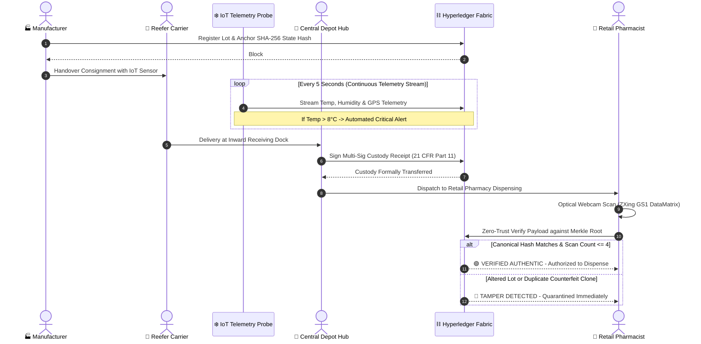

---

## 💫 Live Animated Telemetry & Forensic Visualizers

Medi Trace utilizes native animated SVG vector telemetry engines engineered with zero external dependencies. They render natively inside GitHub markdown, web browsers, and desktop shells to visualize continuous real-time processes:

### 1. ⚡ Live Supply Chain Provenance Transit Pipeline
<p align="center">
  
</p>

> **Dynamic Visual Elements:**
> - **Continuous Batch Transit Pulse (`.moving-particle`):** Demonstrates real-time custody packet flow traversing the 4 critical supply chain checkpoints.
> - **Pulsating Facility Beacons (`.beacon`):** Expanding radar beacons identifying active nodes with cryptographic SHA-256 state anchors.
> - **Acoustic Sensor Activity Bars (`.bar-1` to `.bar-4`):** Dynamic soundwave visualizers reflecting live telemetry packet ingestion.

---

### 2. 🎯 Zero-Trust Optical GS1 DataMatrix Scanner HUD
<p align="center">
  
</p>

> **Dynamic Visual Elements:**
> - **Vertical Neon Targeting Laser (`.scanner-laser`):** Continuous 2.0-second oscillating laser sweep across physical packaging matrices.
> - **Rotating Cybernetic Reticle (`.hud-ring`):** 360-degree holographic crosshair guiding operator alignment.
> - **Live Optical Decoder Status:** Simulates real-time hardware webcam frame analysis and ZXing symbology parsing.

---

### 3. 🔬 Optical Forensic Verification Terminal & GS1 Parser
<p align="center">
  
</p>

> **Dynamic Visual Elements:**
> - **Bi-Directional Laser Sweep (`.sweep-laser`):** Rapid optical matrix interrogation with neon teal glow filter.
> - **Forensic Data Matrix Breakdown:** Deconstructs physical GS1 Application Identifiers (`(01) GTIN-14`, `(17) EXPIRY`, `(10) LOT`, `(21) SERIAL`).
> - **Blinking Terminal Cursor (`.typing-cursor`):** Simulates live automated payload ingestion into the cryptographic verification engine.
> - **Pulsating Cryptographic Shield (`.pass-shield`):** High-frequency emerald glow confirming zero-trust ledger match and tamper-free provenance.

---

### 4. 📡 Cold-Chain Cryogenic Telemetry Radar & ECG Signal Stream
<p align="center">
  
</p>

> **Dynamic Visual Elements:**
> - **Dynamic ECG Fluctuation Pulse Wave (`.ecg-line`):** Oscillating 3.5-second live telemetry waveform monitoring thermal stability.
> - **Active Radar Sweep Beacon (`.beacon-ring`):** Expanding radar ping rings mapping refrigerated freight transit.
> - **Pulsing Sensor Health LEDs (`.live-dot`):** Real-time green sentinel heartbeat tracking IoT UDP/MQTT ingestion buffers.

---

### 5. ⛓️ Cryptographic Merkle Provenance & Consensus Block Pipeline
<p align="center">
  
</p>

> **Dynamic Visual Elements:**
> - **Continuous Hash Packet Propagation (`.flow-packet-1/2/3`):** Traveling SHA-256 data packets crossing peer blocks in staggered 0.8-second intervals.
> - **Pulsating Active Block Commit Beacon (`.active-block`):** Dynamic neon glow on block `#111` signaling real-time Raft consensus finality.
> - **Tamper-Evident Confirmation Badges (`.confirmed-badge`):** Pulsing status badges verifying cryptographic Merkle state validity.

---

## 📸 Live UI Showcase & Visual Tour

Here is a visual showcase of the latest user interface captures from the live Medi Trace platform:

### 1. 📊 National Regulatory Command Center (`ADMIN`)
<p align="center">
  
</p>

> **Description:** The central regulatory inspectorate view (CDSCO/FDA node). Features the national oversight banner with active consensus validation, nationwide KPI counters, real-time cryogenic sentinel radar (5 probes broadcasting at 5000ms intervals), the animated 4-stage distributed custody pipeline, national batch volume allocation bar charts, compliance status donut breakdowns, and live consortium peer status cards (`CDSCO Regulatory Authority`, `Pfizer Bio-Pharma Labs`, `MedExpress Logistics`, `Nordic Vaccine Depot`, `Apollo Pharmacy`).

---

### 2. 📖 Interactive "How to Use" Operational User Guide Modal
<p align="center">
  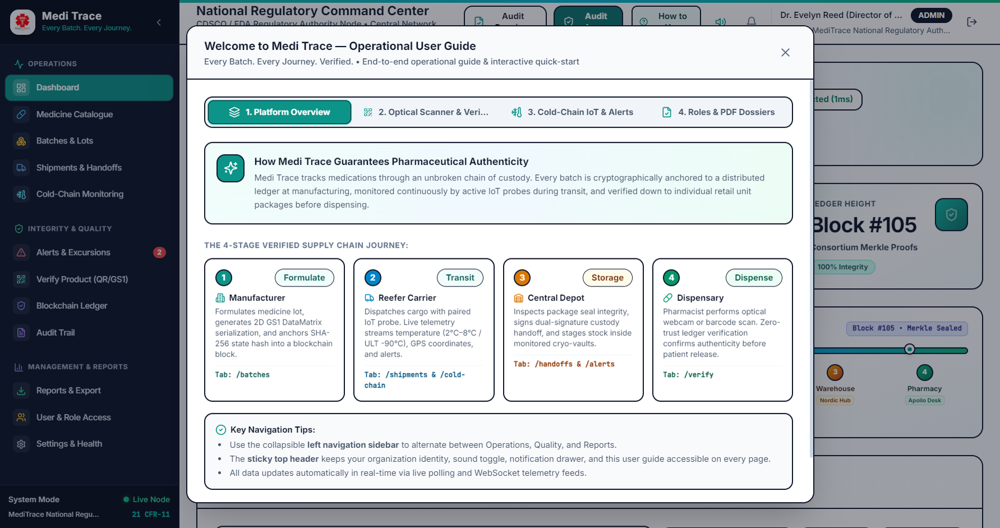
</p>

> **Description:** The automated onboarding modal that launches immediately upon logging in (and is accessible anytime via the **"How to Use"** button in the sticky header). Structured into 4 interactive tabs: *1. Platform Overview & 4-Stage Supply Chain Journey*, *2. Optical Scanner & Verification with 1-Click Test Presets*, *3. Cold-Chain IoT Radar & Excursion Simulation*, and *4. Roles & 21 CFR Part 11 PDF Export Dossiers*. Includes a persistent "Don't show this guide on login" toggle.

---

### 3. 🔍 Zero-Trust Anti-Counterfeit Verification Station (`/verify`)
<p align="center">
  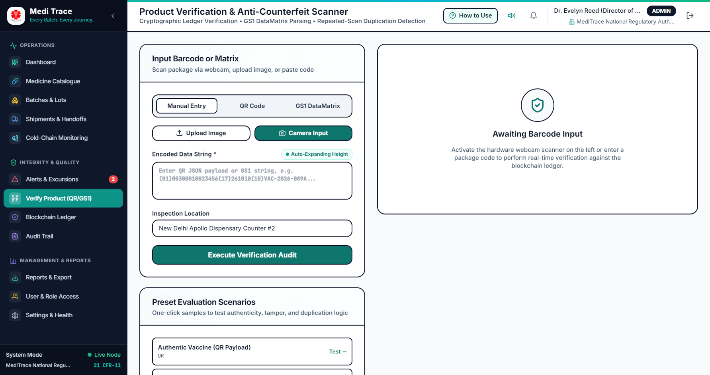
</p>

> **Description:** Optical anti-counterfeit scanning interface powered by `@zxing/library`. Features the high-tech holographic targeting reticle, cybernetic neon scan laser, acoustic soundwave visualizer bars, and a universal GS1 DataMatrix forensic deconstructor (unpacking AI `(01)` GTIN, AI `(17)` Expiry, AI `(10)` Batch, and AI `(21)` Serial Number). Instant preset buttons allow operators to test authentic vaccines, standard GS1 formats, thermal excursion breaches, and unregistered counterfeit clones.

---

### 4. ❄️ Cold-Chain IoT Radar & Interactive GIS Route Map (`/cold-chain`)
<p align="center">
  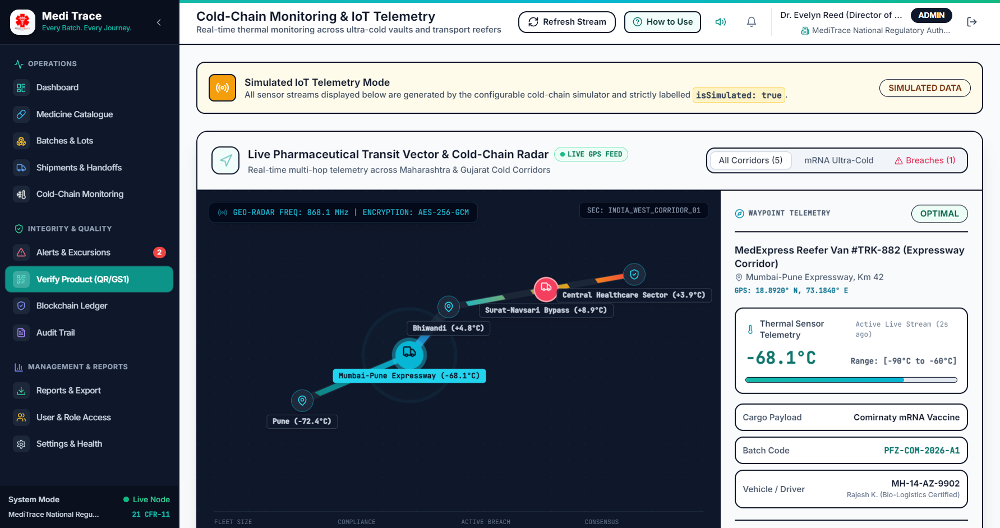
</p>

> **Description:** Interactive topological GIS routing canvas tracking pharmaceutical freight across the **Pune ➔ Mumbai ➔ Surat ➔ Ahmedabad** supply corridor. Displays animated transit vector streams, vehicle waypoints, live sensor telemetry cards (temperature down to -90°C, relative humidity, battery level, GPS ping), and simulation controls (`Trigger Excursion (>8°C)`, `Stabilize (4°C)`, `Drain Battery`) for testing real-world QA incident triage.

---

### 5. ⛓️ Distributed Cryptographic Blockchain Ledger Explorer (`/blockchain`)
<p align="center">
  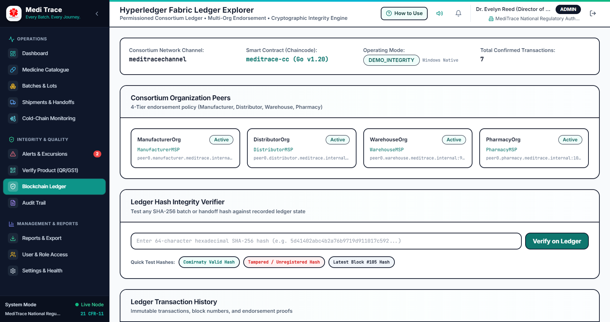
</p>

> **Description:** Comprehensive on-chain ledger explorer detailing block heights, block hashes, previous block hashes, Merkle roots, transaction payloads, and peer endorsement signatures. Features a 1-click **Cryptographic Ledger State Validator** that recalculates the full Merkle tree to prove zero tampering across all historical blocks.

---

### 6. 🔐 Cyber-Pharma Authentication Portal (`/login`)
<p align="center">
  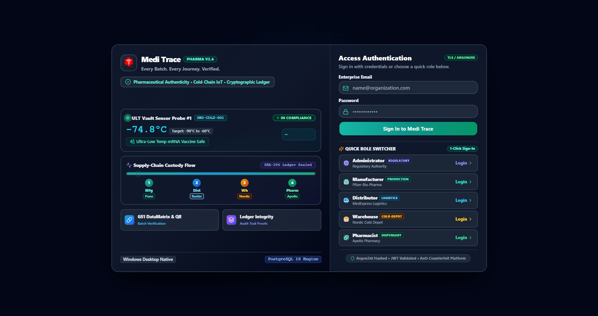
</p>

> **Description:** Split-screen authentication terminal designed in Cyber-Pharma Dark Mode (`bg-slate-950`). Features a live simulated Ultra-Low Temperature vaccine cryo-probe (`-74.8°C` with pulsating compliance beacon and ECG waveform), an animated 4-stage supply chain transit stream, and prominent **1-Click Quick Role Switcher** buttons allowing instant access as Admin, Manufacturer, Distributor, Warehouse Operator, or Pharmacist.

---

## 🌐 Web Application & Site Access

Medi Trace is designed with a **dual-access model** that allows it to operate both as a high-performance web application inside any modern desktop or tablet web browser, and as a native standalone Windows desktop application:

| Deployment Interface | Access URL / Binary | Technology Stack | Best For |
| :--- | :--- | :--- | :--- |
| **Modern Web Browser** | `http://localhost:5173` | React 18 SPA, Vite 5, HTML5 MediaDevices | Instant browser access across workstations (Chrome, Edge, Firefox, Safari) |
| **Native Desktop App** | Electron 30 Shell | Electron + Chromium runtime + IPC Bridge | Dedicated kiosk workstations, offline desktop sessions, native hardware hooks |
| **Standalone Portable .exe** | [`apps/desktop/release/win-unpacked/MediTrace.exe`](file:///d:/projects%20and%20certificates/projects/block/Meditrace/apps/desktop/release/win-unpacked/MediTrace.exe) | Portable compiled Windows binary (177 MB) | Double-click instant execution with zero installation |
| **Windows Setup Installer** | [`apps/desktop/release/MediTrace Setup 1.0.0.exe`](file:///d:/projects%20and%20certificates/projects/block/Meditrace/apps/desktop/release/MediTrace%20Setup%201.0.0.exe) | NSIS Setup Wizard (84.7 MB) | Enterprise installation with desktop shortcuts and uninstaller |

### Web Application Architecture:
- **Responsive Viewport:** Engineered to work seamlessly across widescreen 4K monitors, standard 1080p desktop terminals, and warehouse tablets.
- **Client-Side State Management:** Powered by `@tanstack/react-query` with optimistic updates, stale-while-revalidate caching, and live polling.
- **Micro-Interactions & Hardware APIs:** Direct integration with `navigator.mediaDevices.getUserMedia` for optical camera scanning, and native HTML5 Web Audio API for synthesized acoustic feedback.

---

## 🗺️ Site Navigation & Complete Page-by-Page Tour

The Medi Trace site comprises **14 specialized application portals/pages** organized logically into operational domains:

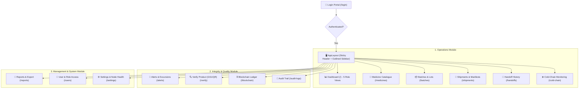

---

### 🔐 Page 1: Cyber-Pharma Authentication Portal (`/login`)
- **Visual Aesthetic:** Immersive Cyber-Pharma Dark Mode featuring a deep obsidian canvas (`bg-slate-950`), glowing teal borders, and an ultra-compact two-column layout.
- **Live Cryo-Vault IoT Sentinel:** Embedded real-time telemetry card showcasing an active Ultra-Low Temperature (ULT) vaccine probe (`-74.8°C`), pulsating emerald compliance beacon, and live animated ECG wave pulse.
- **Cryptographic Custody Pathway:** A dynamic 4-stop animated pathway tracing custody flow across *Manufacturer ➔ Distributor ➔ Warehouse ➔ Pharmacy* with a traveling luminous pulse.
- **1-Click Quick Role Switcher:** Five prominent gradient buttons allowing instantaneous authentication as an Admin, Manufacturer, Distributor, Warehouse Operator, or Pharmacist with zero manual credential typing.
- **Security Primitives:** Validated against the backend via Argon2id cryptographic hashing and JWT session tokens.

<p align="center">
  
</p>

---

### 📖 Interactive Onboarding: "How to Use" User Guide Modal
- **Automatic Post-Login Launch:** Detects whenever an authenticated session is initiated and automatically opens the operational user guide modal.
- **Permanent Top Header Button:** Outfitted with a dedicated **"How to Use"** guide button in [`Header.tsx`](file:///d:/projects%20and%20certificates/projects/block/Meditrace/apps/desktop/src/components/layout/Header.tsx) with a `HelpCircle` icon for instant 1-click access anytime.
- **4 Structured Interactive Tabs:**
  1. *Platform Overview:* Infographic breakdown of the 4-stage verified supply chain journey.
  2. *Optical Scanner & Verification:* Instructions for webcam and manual GS1 decoding, decision matrix, and live 1-click test batch buttons.
  3. *Cold-Chain IoT & Alerts:* Guide to the topological route radar map, probe readings, and real-time excursion simulation triggers.
  4. *Roles & PDF Dossiers:* Overview of the 5 scoped role consoles and 21 CFR Part 11 PDF export engine.
- **User Preference Memory:** Includes a *"Don't show this guide automatically on login"* checkbox stored in `localStorage`.

<p align="center">
  
</p>

---

### 📊 Page 2: Role-Tailored Command Dashboards (`/`)
Rather than a generic layout, the dashboard detects the active user's role and renders one of **5 distinct operational command centers**:

1. **National Regulatory Command Center (`ADMIN`):**
   - CDSCO/FDA inspectorate oversight banner with consensus health monitors.
   - Nationwide counters for registered formulations, active doses, active thermal alarms, and compliance flags.
   - National batch distribution charts and multi-organization peer status cards (`CDSCO Regulatory Authority`, `Pfizer Bio-Pharma Labs`, `MedExpress Logistics`, `Nordic Vaccine Depot`, `Apollo Pharmacy`).
2. **Bio-Pharma Manufacturing & Formulation Desk (`MANUFACTURER`):**
   - Cleanroom batch release throughput counters and cold-chain compliance score.
   - Quick formulation shortcut, production lot status breakdown, and pending blockchain minting queues.
3. **Fleet Logistics & In-Transit Custody Console (`DISTRIBUTOR`):**
   - Live fleet telematics banner (Vehicle `KA-01-EXP-992`), reefer temperature status (`4.8°C USP Standard`), and GPS transit indicators.
   - In-transit consignment counters, pending custody handoffs, and dual-signature sign-off queues.
4. **Cryo-Vault Storage & Inward Dock Terminal (`WAREHOUSE_OPERATOR`):**
   - Live telemetry status for Bay 1 Cryo Vault (`-70.0°C SAFE`) and Bay 2 Cold Room (`4.1°C`).
   - Inward dock intake actions, pallet staging inventory, and active storage alerts.
5. **Retail Dispensing & Anti-Counterfeit Desk (`PHARMACIST`):**
   - Countertop POS verification terminal with quick-scan batch code input.
   - Dispensing inventory count, verified authentic unit logs, and counterfeit discrepancy flags (`100% Genuine`).

<p align="center">
  
</p>

---

### 💊 Page 3: Pharmaceutical Medicine Catalogue (`/medicines`)
- **Product Registry:** Authoritative national catalogue of approved pharmaceutical formulations.
- **Regulatory Identifiers:** National Drug Code (NDC), Global Trade Item Number (GTIN-14), therapeutic category, and dosage form (e.g. *Lyophilized Powder, Multi-Dose Vial, Prefilled Syringe*).
- **Cold-Chain Specifications:** Explicit categorization into `ULT_FROZEN` (`-90°C to -60°C`), `COLD_CHAIN` (`2°C to 8°C`), or `CONTROLLED_ROOM` (`15°C to 25°C`).
- **Registration Modal:** In-app modal for registering new brand formulations with client-side validation.

---

### 📦 Page 4: Batch Serialization & Lot Lifecycle (`/batches`)
- **Lot Lifecycle State Machine:** Tracks batches through discrete regulatory stages: `REGISTERED` ➔ `IN_TRANSIT` ➔ `STORED` ➔ `DELIVERED` ➔ `QUARANTINED` / `RECALLED`.
- **Automated Serialization Engine:** Generates high-density GS1 DataMatrix codes and QR labels containing encoded batch metadata, GTIN, expiry, and cryptographic signatures.
- **Lot Dossier Modal:** Detailed view displaying dosage units, production timestamps, parent formulation, and blockchain transaction IDs.
- **Urgent Regulatory Recall Action:** Instant 1-click regulatory recall modal that flags lots across all supply chain nodes and writes a tamper-evident event to the distributed ledger.

---

### 🚚 Page 5: Custody Shipments & Transport Manifests (`/shipments`)
- **Multi-Leg Logistics Manifests:** Manages shipments moving between manufacturing cleanrooms, distribution hubs, and retail dispensaries.
- **Vehicle & Sensor Pairing:** Pairs active transit consignments with reefer vehicles and IoT telemetry sensor probes.
- **Dispatch Consignment Modal:** Form for dispatching new shipments with origin, destination, carrier notes, and target temperature bands.
- **Electronic Sign-Off:** Digital handoff confirmation adhering to 21 CFR Part 11 requirements.

---

### 🤝 Page 6: Chain-of-Custody Handoff History (`/handoffs`)
- **Dedicated Physical Transfer Ledger:** Historical audit log documenting every physical exchange of custody between supply chain organizations.
- **Handoff Verification Proofs:** Displays transferring agent, receiving agent, facility locations, physical seal inspection notes, and cryptographic transaction endorsement hashes.
- **Endorsement Verification:** Cross-references the digital signatures of both counterparties against the blockchain consensus ledger.

---

### ❄️ Page 7: Real-Time Cold-Chain IoT Monitoring & GIS Route Radar (`/cold-chain`)
- **Interactive GIS Route Map (`InteractiveRouteMap.tsx`):**
  - High-definition animated route lines mapping active transit corridors (e.g. *Pune Plant ➔ Mumbai Port ➔ Surat Depot ➔ Ahmedabad Hub*).
  - Glowing moving pulses (`.animate-transit-stream`) illustrating live cargo movement.
  - Pulsing radar hotspots (`.animate-radar-ring`) highlighting active inspection waypoints.
- **Real-Time Sensor Telemetry Grid:** Live telemetry cards displaying ambient temperature, relative humidity, battery percentage, GPS coordinates, signal strength, and last ping timestamp.
- **Interactive Excursion Simulation Bar:** Live test triggers allowing operators to simulate real-world events:
  - 🔴 `Trigger Excursion (>8°C)` — Instantly injects a temperature spike to test alarm escalation.
  - 🟢 `Stabilize (4°C)` — Normalizes sensor telemetry back into compliant range.
  - ⚡ `Drain Battery` — Simulates sensor power loss for maintenance triage.

<p align="center">
  
</p>

> **Live Cold-Chain Telemetry Radar (Above):** Animated SVG telemetry monitor displaying real-time temperature ECG waveform fluctuations (`.ecg-line`), active beacon radar ping rings (`.beacon-ring`), and live green sentinel health indicators (`.live-dot`).

<p align="center">
  
</p>

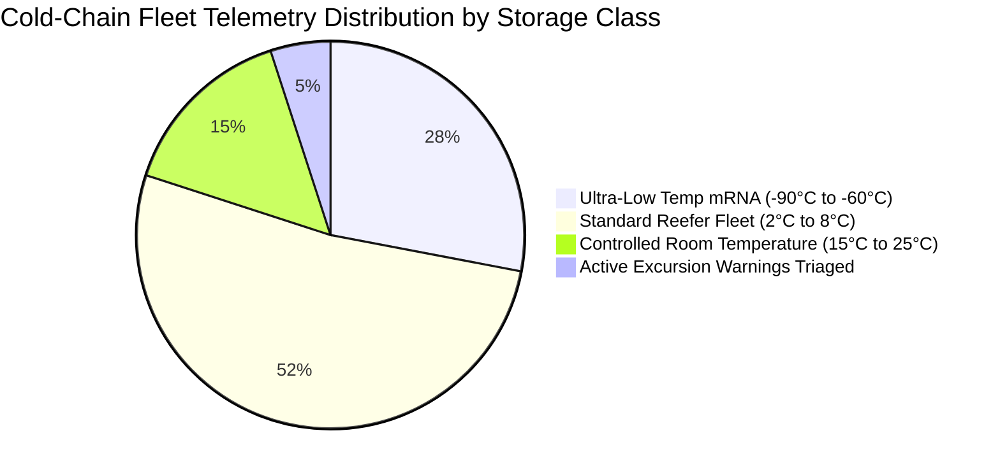

---

### 🚨 Page 8: Excursion Alerts & CAPA Resolution (`/alerts`)
- **Severity-Tiered Alert Stream:** Flags temperature excursions classified into `CRITICAL`, `HIGH`, `MEDIUM`, and `LOW` severities with dynamic countdown timers.
- **QA Triage Workflow:**
  - **Acknowledge:** Operators attach initial inspection notes to prevent duplicate triage.
  - **Resolve & CAPA Modal:** Requires root-cause analysis (e.g., *Reefer door gasket seal breach, compressor reset*) and Mean Kinetic Temperature (MKT) budget verification before clearing the alert.
- **Sidebar Notification Badge:** Displays a real-time unread counter in the navigation sidebar that updates automatically as excursions occur.

---

### 🔍 Page 9: Zero-Trust Anti-Counterfeit Verification Station (`/verify`)
- **Dual Verification Modes:**
  1. **Optical Camera Viewfinder:** Hardware webcam integration powered by `@zxing/library` with a futuristic holographic HUD:
     - Rotating cybernetic targeting reticle (`.animate-holo-rotate`).
     - Glowing neon scanning laser sweep (`.animate-holo-laser`).
     - Real-time acoustic soundwave visualizer bars (`.animate-soundwave-1` through `5`).
     - Formal GAMP 5 & 21 CFR Part 11 camera permission consent modal with camera device switcher.
  2. **Manual & Barcode Image Input:** Auto-expanding textarea accepting raw alphanumeric codes, serialized QR JSON payloads, GS1 strings, or file uploads.
- **Universal GS1 DataMatrix Forensic Parser:** Automatically decomposes 2D barcodes into Application Identifiers:
  - `(01)` Global Trade Item Number (GTIN-14)
  - `(17)` Expiration Date (YYMMDD format)
  - `(10)` Batch / Lot Number
  - `(21)` Unique Serial Number
- **Zero-Trust Verification Engine Outcomes:**
  - 🟢 **VERIFIED AUTHENTIC:** Canonical SHA-256 hash matches ledger block; batch is unexpired and within duplication threshold (scan count ≤ 4).
  - 🟡 **DUPLICATE SUSPICIOUS:** Hash matches, but scan count exceeds safe retail threshold (identifies cloned packaging).
  - 🔴 **TAMPER DETECTED:** Payload signatures or batch data do not match on-chain cryptographic state.
  - 🚫 **INVALID / COUNTERFEIT:** Unknown batch unrecorded on the distributed ledger.
- **Interactive Troubleshooting Guide:** Built-in guidance panel explaining verification outcomes with 1-click test buttons for authentic, in-transit, excursion-flagged, and counterfeit batches.

<p align="center">
  
</p>

> **Zero-Trust Optical Terminal Animation (Above):** Real-time SVG animation illustrating laser sweeping over 2D matrix cells (`.sweep-laser`), GS1 Application Identifier decomposition (`(01) GTIN`, `(17) EXP`, `(10) LOT`, `(21) SERIAL`), dynamic terminal typing cursor (`.typing-cursor`), and pulsing green cryptographic authenticity shield (`.pass-shield`).

<p align="center">
  
</p>

> **Scanner HUD Animation (Above):** Animated viewfinder showing the rotating cybernetic targeting reticle (`.hud-ring`), neon laser targeting sweep, and real-time acoustic soundwave visualizer bars.

<p align="center">
  
</p>

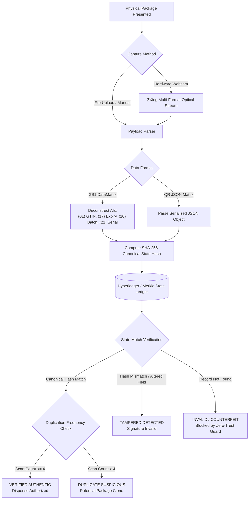

---

### ⛓️ Page 10: Distributed Blockchain Ledger Explorer (`/blockchain`)
- **Block & Transaction Explorer:** Inspect block heights, transaction IDs, block hashes, previous block hashes, Merkle roots, and consensus endorsement timestamps.
- **Dual Engine Architecture:**
  - `DEMO_INTEGRITY`: Native cryptographic SHA-256 Merkle chain running natively on Windows.
  - `FABRIC_LIVE`: Enterprise multi-peer Hyperledger Fabric cluster with Go smart contracts.
- **Cryptographic State Integrity Validator:** 1-click tool that recalculates Merkle roots across all blocks and confirms zero database tampering.
- **Raw Transaction Payload Inspector:** View serialized transaction metadata, endorsing peer signatures, and smart contract function invocations.

<p align="center">
  
</p>

> **Blockchain Consensus Animation (Above):** Live SVG animation tracing cryptographic SHA-256 state packets propagating between peer blocks (`.flow-packet`), active block commit beacon glow (`.active-block`), and Merkle root tamper-evident confirmation badges.

<p align="center">
  
</p>

---

### 📜 Page 11: 21 CFR Part 11 Electronic Security Audit Trail (`/audit-logs`)
- **Tamper-Evident Chronological Trail:** Immutable log recording all critical platform events: user authentications, batch formulations, custody handoffs, thermal alarms, and report generations.
- **Forensic Attributes:** Records exact timestamp, actor email, enterprise organization, event category (`AUTH`, `BATCH`, `SHIPMENT`, `TELEMETRY`, `SECURITY`), severity rating (`INFO`, `WARN`, `CRITICAL`), and IP address.
- **Search & Filter Controls:** Multi-parameter search by user email, action keyword, date range, and severity level.

---

### 📑 Page 12: Regulatory Dossiers & Role-Tailored PDF Export (`/reports`)
- **Automated A4 Regulatory Dossier Engine:** Built with `jsPDF` and `jspdf-autotable` to produce publication-ready compliance documents adhering to Good Laboratory and Distribution Practices.
- **5 Dynamic Role-Specific Dossiers:** Rather than generic dumps, clicking **Export PDF** generates tailored dossiers based on the logged-in user:
  1. **ADMIN:** *National Regulatory Oversight & Inspection Dossier* — Nationwide compliance rates, active alerts, and CDSCO regulatory clearance.
  2. **MANUFACTURER:** *Certificate of Analysis & Batch Release Dossier* — Cleanroom formulation parameters, release quantities, and Merkle proofs.
  3. **DISTRIBUTOR:** *Chain-of-Custody Logistics & Transport Manifest* — Carrier vehicle IDs, temperature logs, and handoff custody sign-offs.
  4. **WAREHOUSE OPERATOR:** *Cold-Vault Environmental & Storage Dossier* — Vault probe logs, excursion duration records, and quarantine summaries.
  5. **PHARMACIST:** *Point-of-Dispense Verification & Safety Audit Certificate* — Optical scan logs, GTIN matches, and dispensing authorizations.
- **Dossier Features:** Embedded high-resolution vector charts (Bar & Donut), diagonal security watermarks, running headers, and 21 CFR Part 11 digital auditor attestations.

---

### 👥 Page 13: Multi-Tenant User Directory & Permissions (`/users`)
- **Role-Based Access Control (RBAC):** Admin-only portal for provisioning and auditing enterprise user accounts.
- **Tenant Assignment:** Links users to specific organizational nodes (`CDSCO Inspectorate`, `Pfizer Bio-Pharma Labs`, `MedExpress Logistics`, `Nordic Vaccine Depot`, `Apollo Central Pharmacy`).
- **User Provisioning Modal:** Form for adding new users with role-scoped permissions and pre-hashed credentials.

---

### ⚙️ Page 14: Node Health Probes & System Diagnostics (`/settings`)
- **Real-Time Health Diagnostics:** Live latency checks for the Core REST API, local PostgreSQL database connection pool, IoT Simulator probe broadcast, and Blockchain consensus engine.
- **Acoustic Audio System Controls:** Global toggle for synthesized UI sound effects with volume level adjustment.
- **Environment & Build Information:** Displays active API endpoints, database connection URLs, client versions, and network topology.

---

## 👥 Enterprise User Roles & 1-Click Role Switcher

All accounts are secured with **Argon2id** memory-hard hashing. The login page provides an instant **1-Click Quick Role Switcher** with high-contrast buttons for rapid testing without entering credentials:

| Role | Email | Password | Organization | Scoped Operational Capabilities |
| :--- | :--- | :--- | :--- | :--- |
| **Administrator** | `admin@meditrace.internal` | `Admin@123456` | National Regulatory Authority | Full system oversight, ledger consensus, global audit logs, user management |
| **Manufacturer** | `manufacturer@pfizer-demo.com` | `Mfg@123456` | Pfizer Bio-Pharma Labs | Create batches, serialize lots, print 2D QR labels, view plant sensors |
| **Distributor** | `distributor@medexpress.com` | `Dist@123456` | MedExpress Cold Logistics | Manage reefer fleet, sign handoffs, monitor live transit telemetry |
| **Warehouse Operator**| `warehouse@nordic-hub.com` | `Wh@123456` | Nordic Central Vaccine Depot | Inward dock intake, manage cryo-vault storage, track warehouse probes |
| **Pharmacist** | `pharmacist@apollo-central.com` | `Pharm@123456` | Apollo Central Healthcare Pharmacy | Verify GS1/QR packages, dispense medication to patients, confirm final custody |

---

## 🎨 UI Design System & Sensory Highlights

### ☀️ Permanent High-Contrast Light Mode
Medi Trace enforces a permanent, high-readability Light Mode across all 13 operational pages to ensure optimal visibility in laboratory cleanrooms, warehouse docks, and dispensary desks:
- **Clean Surgical Surfaces:** Crisp white (`#ffffff`) and soft slate (`#f8fafc`) backgrounds paired with deep navy (`#0f172a`, `#1e293b`) typography.
- **Zero Visual Inversion:** Recharts visual graphs, modal dialogs, QR code canvases, and data grids are calibrated specifically for daylight legibility without muddy gradients.

### 🖤 Industrial Dark Outlines (`border-2 border-slate-900`)
Every interactive element, card container, command banner, modal window, and input field features an industrial, high-contrast dark outline:
- **Neo-Brutalist Precision:** High-visibility 2px solid slate-900 borders (`border-2 border-slate-900`) create razor-sharp separation between dashboard cards, role ribbons, and operational pods.
- **Outlined Buttons & Badges:** Primary, secondary, danger, and outline buttons ([Button.tsx](file:///d:/projects%20and%20certificates/projects/block/Meditrace/apps/desktop/src/components/common/Button.tsx)) and status badges ([Badge.tsx](file:///d:/projects%20and%20certificates/projects/block/Meditrace/apps/desktop/src/components/common/Badge.tsx)) feature dark borders that prevent blending into white surfaces.
- **Accessible Form Elements:** Inputs, select dropdowns, and search bars use crisp 2px dark outlines with teal focus rings.

### 🔔 Synthesized Acoustic Feedback System (`soundService.ts`)
Tactile acoustic sound synthesis built with the native Web Audio API (zero external audio file downloads):
- **Click Sound:** Subtle sine pulse on navigation and button clicks.
- **Modal Transition:** Smooth pitch sweep on dialog open/close (`playModalOpen()`, `playModalClose()`).
- **Harmonic Success:** 4-tone ascending major chord when completing an operation.
- **Thermal Alert:** Distinct double-frequency warning sound when an excursion triggers.
- **Mute / Unmute:** Click the speaker icon in the top header at any time to toggle acoustic feedback.

### 📣 Toast Notification Center & Persistent History Drawer
- **Real-Time Pop-Up Alerts:** High-contrast outlined toasts with dynamic countdown timers, pause-on-hover, and instant dismiss controls.
- **Notification History Center:** Dropdown drawer in the header logging all real-time events with test trigger controls (`Success`, `Alert`, `Error`).
- **Sticky Glassmorphic Header:** Floats docked at the top of the viewport with a blurred backdrop (`backdrop-blur-md`), accent gradient indicator, and the permanent **"How to Use"** guide launcher.

---

## 🏗️ Architecture & Monorepo Structure

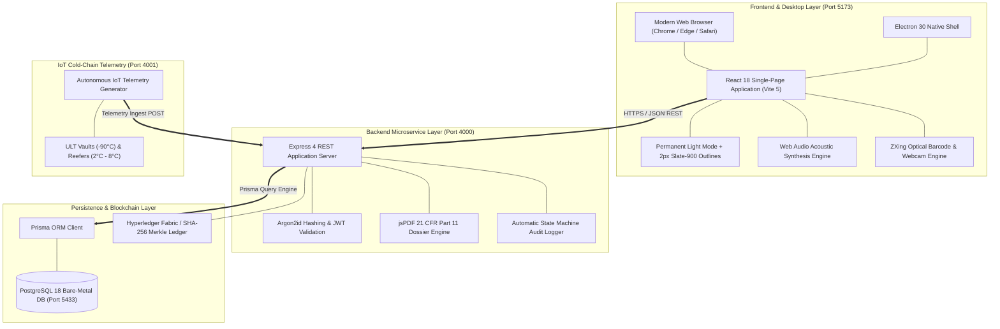

Medi Trace is organized as an npm workspace monorepo separating API services, web/desktop client, distributed ledger contracts, database persistence, and IoT simulator engines:

---

## 📁 Project Directory Structure

```text
Meditrace/
├── 📁 apps/
│   ├── 📁 api/                              # Backend REST Microservice Layer (Port 4000)
│   │   ├── 📁 src/
│   │   │   ├── 📄 app.ts                    # Express application instance & CORS security middleware
│   │   │   ├── 📄 server.ts                 # HTTP server entry point & graceful shutdown handlers
│   │   │   ├── 📁 assets/                   # Static logos & brand vectors for PDF generation
│   │   │   ├── 📁 config/                   # JWT secrets, environment constants, & server settings
│   │   │   ├── 📁 db/                       # Prisma client connection pool & query engine
│   │   │   ├── 📁 middleware/               # Auth guard, RBAC validator, 21 CFR Part 11 audit logger
│   │   │   ├── 📁 modules/                  # Domain-driven feature controllers & routes
│   │   │   │   ├── 📁 alerts/               # IoT thermal excursion detection, triage & resolution APIs
│   │   │   │   ├── 📁 audit/                # Immutable security & electronic signature audit trails
│   │   │   │   ├── 📁 auth/                 # Argon2id hashing & JWT authentication endpoints
│   │   │   │   ├── 📁 batches/              # Batch serialization, lot registration, & recall lifecycle
│   │   │   │   ├── 📁 blockchain/           # SHA-256 Merkle root & Hyperledger verification endpoints
│   │   │   │   ├── 📁 health/               # Database connectivity & node health probes
│   │   │   │   ├── 📁 products/             # Pharmaceutical brand formulation catalogue
│   │   │   │   ├── 📁 reports/              # 21 CFR Part 11 PDF regulatory dossier exports & CSV tables
│   │   │   │   ├── 📁 shipments/            # Multi-stage chain-of-custody transfer & handoff workflows
│   │   │   │   ├── 📁 telemetry/            # IoT probe ingest & live streaming telemetry buffers
│   │   │   │   ├── 📁 users/                # Multi-tenant user directory & permission management
│   │   │   │   └── 📁 verification/         # Zero-Trust GS1 DataMatrix optical validator endpoints
│   │   │   └── 📁 services/                 # jsPDF dossier engine, QR generator, blockchain stub
│   │   ├── 📄 package.json                  # API dependencies (Express, Prisma, jsPDF, Argon2id)
│   │   └── 📄 tsconfig.json                 # Node.js TypeScript compilation target
│   │
│   └── 📁 desktop/                          # Web SPA & Electron Desktop Client (Port 5173)
│       ├── 📁 electron/                     # Electron main process & desktop window lifecycle
│       │   ├── 📄 main.ts                   # Native BrowserWindow creation, CSP, IPC listeners
│       │   └── 📄 preload.ts                # Context bridge exposing secure desktop primitives
│       ├── 📁 public/                       # Static assets, branding logo & Windows .ico icon
│       │   ├── 🖼️ icon.ico                  # Multi-resolution embedded application icon
│       │   ├── 🖼️ logo.png                  # Official MediTrace Red Cross Caduceus logo
│       │   └── 🖼️ logo-tight.png            # High-DPI compact navigation badge
│       ├── 📁 release/                      # Packaged Windows standalone executables
│       │   ├── 🚀 MediTrace Setup 1.0.0.exe # Standalone NSIS Windows setup wizard installer (84.7 MB)
│       │   └── 📁 win-unpacked/             # Portable standalone unpacked binary directory
│       │       └── 🚀 MediTrace.exe         # Direct double-click portable desktop executable (177 MB)
│       ├── 📁 src/                          # React 18 Single-Page Application (SPA)
│       │   ├── 📄 App.tsx                   # HashRouter routing table & authenticated layout
│       │   ├── 📄 main.tsx                  # React DOM root bootstrapping & React Query client
│       │   ├── 📁 components/               # Reusable high-contrast design system components
│       │   │   ├── 📁 coldchain/            # Interactive GIS Route Map & telemetry gauges
│       │   │   ├── 📁 common/               # Button, Modal, Card, StatCard, Badge, Toasts
│       │   │   ├── 📁 guide/                # HowToUseModal interactive user guide
│       │   │   └── 📁 layout/               # Sticky Header, Category Sidebar, AppLayout
│       │   ├── 📁 context/                  # React Contexts (AuthContext, ToastContext, ThemeContext)
│       │   ├── 📁 pages/                    # 14 Enterprise Application Functional Pages
│       │   │   ├── 📄 LoginPage.tsx         # Cyber-Pharma Dark Auth with 1-click role switcher
│       │   │   ├── 📄 DashboardPage.tsx     # 5 distinct persona-tailored command centers
│       │   │   ├── 📄 MedicinesPage.tsx     # Formulation catalogue & new brand registration
│       │   │   ├── 📄 BatchesPage.tsx       # Lot serialization, barcode dossier, recall modal
│       │   │   ├── 📄 ShipmentsPage.tsx     # Custody transit manifests & handoff signing
│       │   │   ├── 📄 HandoffHistoryPage.tsx# Chain-of-custody transfer records & signatures
│       │   │   ├── 📄 ColdChainPage.tsx     # Live IoT thermal map, reefer gauges & sensors
│       │   │   ├── 📄 AlertsPage.tsx        # Excursion triage, ack notes, resolution modal
│       │   │   ├── 📄 VerificationPage.tsx  # Holographic optical scanner & GS1 payload validator
│       │   │   ├── 📄 BlockchainPage.tsx    # Ledger block explorer & SHA-256 hash verifier
│       │   │   ├── 📄 AuditLogsPage.tsx     # 21 CFR Part 11 security events & activity search
│       │   │   ├── 📄 ReportsPage.tsx       # Role-tailored regulatory PDF export & CSV tables
│       │   │   ├── 📄 UsersPage.tsx         # Multi-tenant user provisioning & role access
│       │   │   └── 📄 SettingsPage.tsx      # System node health, API status & mute toggle
│       │   ├── 📁 services/                 # API REST client, audio synthesis service (soundService)
│       │   └── 📁 styles/                   # index.css (High-contrast 2px borders, animations)
│       ├── 📄 index.html                    # Web & Desktop HTML5 entry point
│       ├── 📄 package.json                  # Desktop workspace configuration & build scripts
│       ├── 📄 tailwind.config.js            # Design system palette, Navy-900 & Teal tokens
│       └── 📄 vite.config.ts                # Vite bundler configuration with relative pathing
│
├── 📁 blockchain/
│   └── 📁 fabric/                           # Hyperledger Fabric Enterprise Ledger Infrastructure
│       └── 📁 chaincode/                    # Smart contracts & business rules
│           ├── 📄 go.mod                    # Go module definition
│           └── 📄 meditrace_contract.go     # Go smart contract for immutable pharmaceutical lots
│
├── 📁 database/
│   ├── 📁 pgdata/                           # Dedicated non-Docker PostgreSQL cluster storage
│   └── 📁 prisma/                           # Schema definition & database models
│       └── 📄 schema.prisma                 # 14 normalized relational entities & foreign keys
│
├── 📁 packages/
│   └── 📁 shared-types/                     # Shared TypeScript Definitions Monorepo Package
│       ├── 📁 src/
│       │   └── 📄 index.ts                  # Shared interfaces, UserRole enums, BatchStatus DTOs
│       ├── 📄 package.json                  # Shared types package definition
│       └── 📄 tsconfig.json                 # TypeScript build configuration
│
├── 📁 scripts/
│   ├── 📄 capture-screenshots.js            # Automated headless UI screenshot capturer
│   ├── 📄 db-setup.js                       # Non-Docker PostgreSQL cluster & DB initializer
│   ├── 📄 db-seed.js                        # Multi-tenant enterprise role demo dataset seeder
│   └── 📄 start-all.js                      # Cross-platform concurrency process orchestrator
│
├── 📁 services/
│   └── 📁 iot-simulator/                    # Autonomous IoT Cold-Chain Probe Simulator (Port 4001)
│       ├── 📁 src/
│       │   └── 📄 index.ts                  # Simulated telemetry generator (-90°C to +8°C)
│       ├── 📄 package.json                  # IoT simulator package definition
│       └── 📄 tsconfig.json                 # Simulator TypeScript configuration
│
├── 📁 docs/
│   └── 📁 images/                           # High-resolution architectural previews & UI captures
│       ├── 🖼️ logo.png                      # Official project emblem
│       ├── 🖼️ ui-dashboard-admin.png        # Live capture: National Regulatory Command Center
│       ├── 🖼️ ui-user-guide-modal.png       # Live capture: "How to Use" operational guide popup
│       ├── 🖼️ ui-verification-scanner.png   # Live capture: Optical GS1 DataMatrix scanner HUD
│       ├── 🖼️ ui-cold-chain-map.png         # Live capture: Interactive GIS Route Map
│       ├── 🖼️ ui-blockchain-ledger.png      # Live capture: Distributed ledger block explorer
│       ├── 🖼️ ui-login-portal.png           # Live capture: Cyber-Pharma Dark login terminal
│       ├── 🖼️ blockchain-consensus.svg      # Animated blockchain consensus pipeline
│       ├── 🖼️ cold-chain-telemetry.svg      # Animated cold-chain telemetry radar
│       └── 🖼️ scanner-hud.svg               # Animated optical scanner HUD
│
├── 📄 .env                                  # Active environment configuration
├── 📄 .env.example                          # Sample environment configuration template
├── 📄 .gitignore                            # Clean Git repository ignore specifications
├── 📄 EXTENSIONS_AND_PACKAGES_NEEDED.md     # 38 Tech stack packages with authentic badges
├── 📄 HOW_TO_RUN.md                         # Detailed step-by-step setup and launch guide
├── 📄 PROJECT_PROGRESS.md                   # Chronological project milestones and audit history
├── 📄 RUN_MEDITRACE.bat                     # Double-click one-shot Windows launch batch script
├── 📄 package.json                          # Root monorepo workspace manifest & unified scripts
└── 📄 README.md                             # Comprehensive project documentation
```

---

## 💻 System Requirements & Network Ports

- **Operating System:** Windows 10 or Windows 11 (64-bit)
- **Node.js:** `v20.x` or `v24.x` (Verified: `v24.11.1`)
- **Package Manager:** `npm` `v10.x` or `v11.x` (Verified: `v11.5.2`)
- **Database:** PostgreSQL `16.x+` or `18.x` (Standard default binary path: `C:\Program Files\PostgreSQL\18\bin`)
- **Docker Status:** **Zero Docker Required.** The platform runs bare-metal natively on Windows.

### Network Ports & Service Map:
| Service | Local URL / Port | Protocol | Purpose |
| :--- | :--- | :--- | :--- |
| **Frontend Web App** | `http://localhost:5173` | HTTP / WebSocket (HMR) | Web application interface in any browser |
| **Backend REST API** | `http://localhost:4000` | HTTP / JSON | Core business logic & database controller |
| **API Health Probe** | `http://localhost:4000/api/health` | HTTP / JSON | Microservice & database liveness probe |
| **IoT Cold-Chain Simulator** | `http://localhost:4001` | HTTP / Ingest | Autonomous telemetry generator (`/status`) |
| **PostgreSQL Database** | `localhost:5433` | TCP / PostgreSQL Wire | Dedicated bare-metal cluster in `database/pgdata` |

---

## ⚡ Quick Start Guide

### Step 1: Clone Repository & Install Dependencies
```powershell
git clone https://github.com/Rohanjm911/Meditrace.git
cd Meditrace
npm install
```

### Step 2: Environment Configuration
Copy the sample environment file:
```powershell
Copy-Item .env.example .env
```
Default parameters in `.env`:
```ini
PORT=4000
DATABASE_URL="postgresql://postgres@localhost:5433/meditrace"
JWT_SECRET="meditrace-secure-production-ready-jwt-secret-key-32chars"
FABRIC_MODE="DEMO_INTEGRITY"
IOT_SIMULATOR_PORT=4001
```

### Step 3: Initialize Database & Populate Seed Records
Run the automated non-Docker database provisioning script:
```powershell
npm run db:setup
```
*This verifies your local PostgreSQL installation, provisions a dedicated cluster on port `5433` (in `database/pgdata`), and applies all Prisma database migrations.*

Next, populate the demo dataset:
```powershell
npm run db:seed
```

### Step 4: Launch Medi Trace
Choose any of the three launch options:

#### Option A: One-Click Windows Batch (Fastest)
Double-click **`RUN_MEDITRACE.bat`** in the root directory.

#### Option B: Unified Terminal Launcher
```powershell
npm run dev
```
Then open your browser to **`http://localhost:5173`** or interact with the auto-spawned Electron desktop window.

#### Option C: Native Standalone Windows Executable (.exe)
Double-click either prebuilt binary in `apps/desktop/release/`:
- **Portable App:** `apps/desktop/release/win-unpacked/MediTrace.exe` (177 MB)
- **Setup Wizard:** `apps/desktop/release/MediTrace Setup 1.0.0.exe` (84.7 MB)

---

## 🛠️ Available Scripts

| Command | Action |
| :--- | :--- |
| `npm run dev` | Unified startup: Launches API, IoT Simulator, and Desktop/Web UI concurrently |
| `npm run dev:api` | Starts only the Express REST API in hot-reload mode (`tsx watch`) |
| `npm run dev:desktop` | Starts only the Vite development server on `http://localhost:5173` |
| `npm run dev:simulator` | Starts only the IoT Sensor telemetry simulator on port `4001` |
| `npm run build` | Compiles TypeScript across all workspace packages and produces Vite bundles |
| `npm test` | Executes the Vitest automated test suite |
| `npm run typecheck` | Runs strict TypeScript type-checking across all packages |
| `npm run db:setup` | Configures local PostgreSQL cluster and synchronizes Prisma schema |
| `npm run db:seed` | Populates mock medicines, batches, shipments, sensors, and users |
| `npm run db:studio` | Launches Prisma Studio GUI for database inspection |
| `npm run package:win` | Packages the desktop application as a standalone Windows `.exe` installer |

---

## 🧪 Recommended Seed Batches for Live Testing

Navigate to **Verify Product (`/verify`)** on the site and test the following seeded packages:

| Batch Number | Medicine Product | Cold-Chain Spec | Status | Expected Verification Result |
| :--- | :--- | :--- | :--- | :--- |
| **`VAC-2026-089A`** | Comirnaty COVID-19 Vaccine | `-90°C to -60°C` (ULT Vault) | `REGISTERED` | 🟢 **Verified Authentic:** Canonical SHA-256 match, complete Merkle proof. |
| **`VAX-2026-104B`** | Pneumococcal Conjugate | `2°C to 8°C` (Standard Cold) | `IN_TRANSIT` | 🟢 **GS1 DataMatrix:** AI `(01)` GTIN, AI `(17)` Expiry, AI `(10)` Batch, AI `(21)` Serial. |
| **`ROT-2026-441D`** | Rotarix Oral Vaccine | `2°C to 8°C` (Reefer Truck) | `QUARANTINED` | 🔴 **Excursion Detected:** Temperature breach history flagged in verification summary. |
| **`FAKE-COUNTERFEIT-BATCH-9999`** | Unregistered / Fake Lot | None | `INVALID` | 🚫 **Anti-Counterfeit Blocked:** Zero-trust rejection of unregistered codes. |

---

## 📑 Regulatory Dossiers & PDF Generation Engine

Medi Trace incorporates an automated PDF rendering engine powered by `jsPDF` and `jspdf-autotable`. The generated audit sheets adhere to Good Laboratory & Distribution Practices:

1. **Running Headers & Security Watermarks:** Every page features official regulatory headers, running pagination, and diagonal low-opacity security watermarks.
2. **Vector Chart Graphics:** Automatically calculates and draws native vector Bar Charts and Pie/Donut distributions directly into the PDF canvas.
3. **Audit Metadata Box:** Displays inspection timestamps, lead authority identifiers, SOP guidelines, and ledger Merkle roots.
4. **Digital Attestation Block:** 21 CFR Part 11 compliant digital attestation signature certifying ledger state integrity.
5. **Role-Tailored Scope:**
   - **ADMIN:** National Regulatory Oversight & Inspection Dossier
   - **MANUFACTURER:** Certificate of Analysis & Batch Release Dossier
   - **DISTRIBUTOR:** Chain-of-Custody Logistics & Transport Manifest
   - **WAREHOUSE OPERATOR:** Cold-Vault Environmental & Storage Dossier
   - **PHARMACIST:** Point-of-Dispense Verification & Safety Audit Certificate

---

## ⛓️ Hyperledger Fabric & Blockchain Ledger Modes

### Operating Mode 1: `DEMO_INTEGRITY` (Default Windows Environment)
- Uses native SHA-256 canonical hashing for all state changes.
- Maintains immutable block heights, Merkle trees, and multi-organization endorsements in the database.
- Clearly flags transactions as `DEMO_INTEGRITY` to prevent misrepresentation during demonstrations.

### Operating Mode 2: `FABRIC_LIVE` (Linux / WSL2 Multi-Peer Cluster)
- Connects to a live Hyperledger Fabric peer network:
  1. Set up WSL2 (Ubuntu 22.04 LTS) and install Hyperledger Fabric `v2.5.x` binary tools.
  2. Deploy the smart contract located at `blockchain/fabric/chaincode/meditrace_contract.go`.
  3. Set `FABRIC_MODE="FABRIC_LIVE"` in `.env`.

---

## 🔒 Security & Compliance Standards

- **Authentication:** Dual-token JWT architecture with cryptographic expiration.
- **Password Protection:** Argon2id memory-hard hashing algorithm.
- **Audit Logging:** Every state modification generates a permanent, non-repudiation entry in the `audit_logs` table.
- **Electronic Signatures:** Compliant with FDA 21 CFR Part 11 digital signature and record requirements.
- **Zero-Trust Optical Architecture:** Optical scans are checked against the Merkle root on the ledger rather than trusting local package metadata.

---

## ❓ Troubleshooting & FAQ

### Can I access Medi Trace as a standard website in my browser?
Yes! Simply open your web browser (Chrome, Edge, Firefox, Safari) and navigate to **`http://localhost:5173`** while the development server or batch launcher is running. All features, including optical scanning, interactive route maps, charts, and PDF exports, operate identically in the browser.

### Port Conflict on 5432?
The setup script `npm run db:setup` automatically resolves port conflicts by provisioning a dedicated PostgreSQL instance on port `5433` in `database/pgdata`.

### Database Connection Error?
Ensure PostgreSQL is running:
```powershell
& "C:\Program Files\PostgreSQL\18\bin\pg_ctl.exe" -D "database/pgdata" start
```

### Can I test optical webcam scanning without physical medication boxes?
Yes! You can use the built-in 1-click test buttons on the `/verify` page, upload sample barcode images, or use the sample codes listed in the [Recommended Seed Batches](#-recommended-seed-batches-for-live-testing) section.

---

## 📄 License & Attribution

Developed by the **Medi Trace Core Engineering Team**.  
All rights reserved. Dedicated to pharmaceutical safety and transparent global healthcare logistics.
